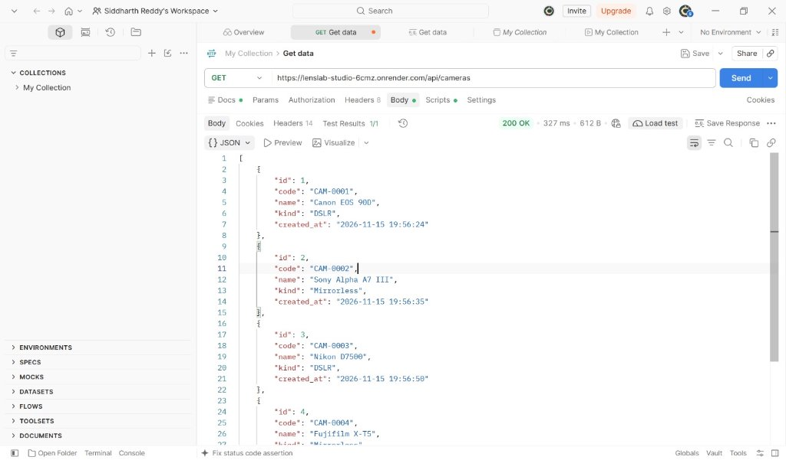
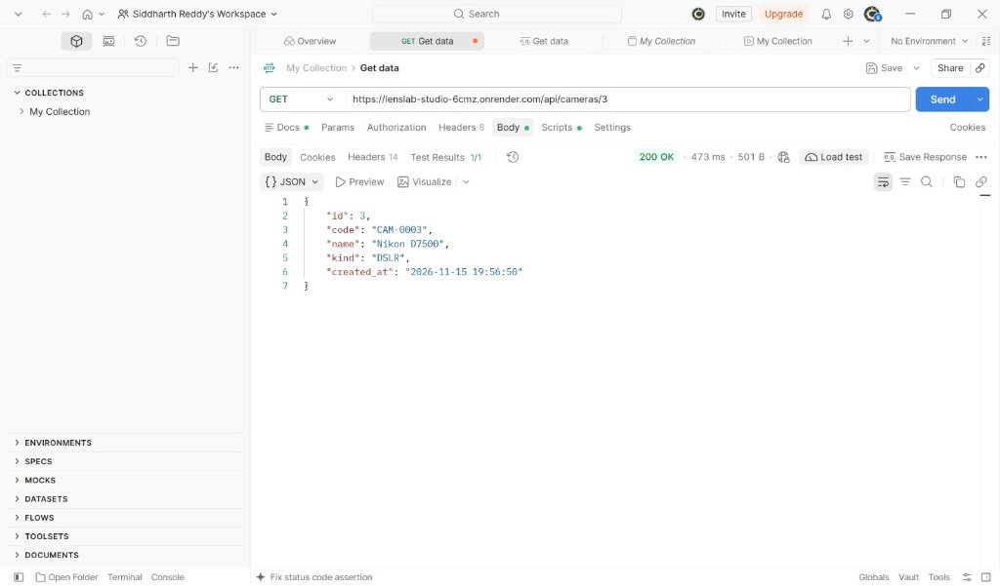
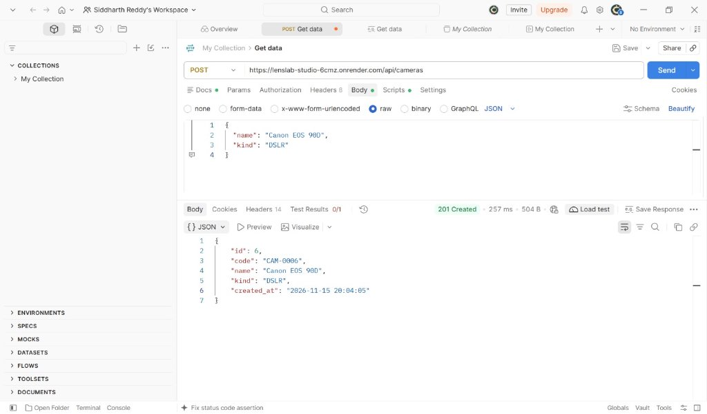
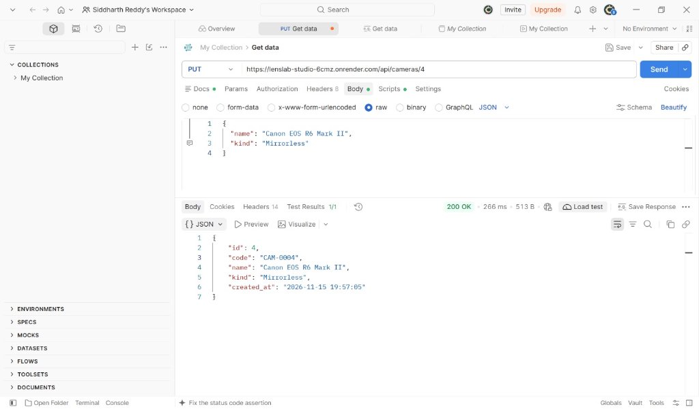
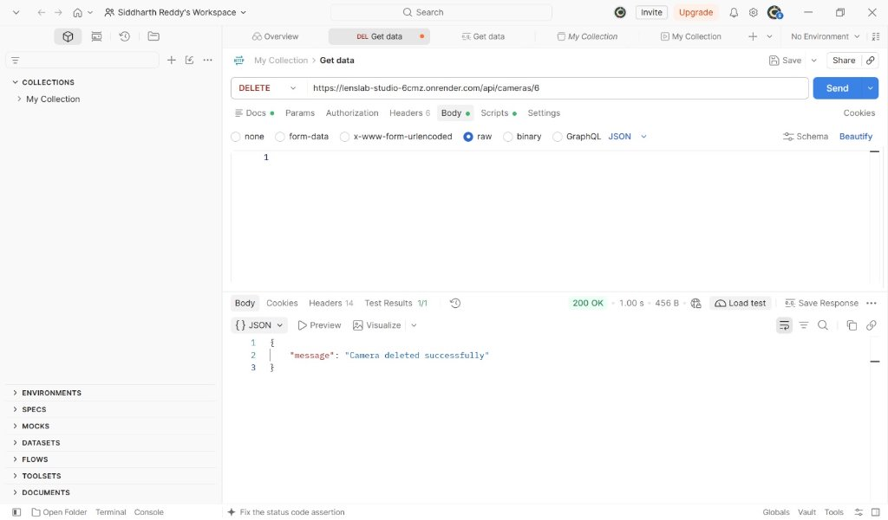

# LensLab Studio – Camera Rental Management System

A backend-based Camera Rental Management System developed using **Node.js, Express.js, and SQLite**. The project provides RESTful APIs to manage cameras, photographers, and rental records. Postman is used for API testing.

---

## 1. Project Overview

LensLab Studio is a Camera Rental Management System designed to simplify the management of camera equipment and rental transactions.

In a manual camera rental process, maintaining camera details, photographer information, and rental records can become difficult. Records may be duplicated, information may be misplaced, and tracking which camera is rented can take additional time.

To address these problems, this project provides a backend application that stores and manages the information using an SQLite database.

The application provides REST API endpoints through which clients can add, view, update, search, and delete records. It also connects photographers with cameras through rental records.

### Main Objectives

- Manage camera equipment and its details.
- Store photographer information.
- Create and retrieve camera rental records.
- Maintain relationships between cameras, photographers, and rentals.
- Perform database operations using SQLite.
- Develop RESTful APIs using Node.js and Express.js.
- Test API requests and responses using Postman.

---

## 2. Technologies Used

| Technology | Purpose |
|---|---|
| Node.js | JavaScript runtime used to execute the backend application. |
| Express.js | Framework used to create the server and API routes. |
| SQLite | Relational database used to store project information. |
| JavaScript | Programming language used for backend logic. |
| SQL | Used to create tables and perform database operations. |
| Postman | Used to send API requests and test responses. |
| Git | Used for version control. |
| GitHub | Used to store the project and manage team contributions. |

---

## 3. Project Modules

The project is divided into three main modules based on the course syllabus.

### Module 1 – Node.js and Express.js Fundamentals

This module focuses on developing the backend server using Node.js and Express.js.

Topics applied:
- Node.js fundamentals.
- NPM and package management.
- HTTP server setup.
- HTTP methods and status codes.
- Request and response handling.
- Express.js routing.
- Modular routing.
- Basic error handling.

### Module 2 – SQLite and Relational Database Operations

This module focuses on storing and managing project information using SQLite.

Topics applied:
- SQLite database creation.
- Database connection and initialization.
- Database schema and tables.
- Primary keys and foreign keys.
- SQL queries.
- Parameterized queries.
- CRUD operations.
- SQL JOIN operations.

### Module 3 – RESTful API Development and Validation

This module focuses on creating and testing RESTful APIs.

Topics applied:
- REST principles.
- API endpoints and HTTP methods.
- Request parameters and query parameters.
- JSON request and response handling.
- Request validation.
- Response formatting.
- HTTP status codes.
- API testing and debugging.

---

## 4. System Architecture

The application follows a simple backend architecture.

```text
             Postman / API Client
                      |
                      |
                HTTP Requests
                      |
                      v
              Node.js + Express
                   Server
                      |
          +-----------+-----------+
          |           |           |
          v           v           v
      Camera API  Photographer   Rental API
                     API           |
          |           |           |
          +-----------+-----------+
                      |
                      v
                SQLite Database
                      |
                      v
                Query Results
                      |
                      v
                JSON Response
```

### Working Process

1. The client sends an HTTP request through Postman.
2. The Express server receives the request.
3. The appropriate API route processes the request.
4. The route performs the required database operation.
5. SQLite executes the SQL query.
6. The result is returned to the Express application.
7. The server sends a JSON response with an appropriate HTTP status code.

---

## 5. Database Design

The project uses SQLite as its relational database. It contains three main entities.

### 5.1 Cameras Table

The Cameras table stores information about the camera equipment available in the system.

Its purpose is to maintain camera records and allow users to retrieve, add, update, search, and delete camera information.

### 5.2 Photographers Table

The Photographers table stores details of photographers who rent camera equipment.

It helps maintain the information of people associated with rental transactions.

### 5.3 Rentals Table

The Rentals table stores the rental transactions.

It connects the Cameras and Photographers tables using foreign keys. This allows the system to identify which photographer rented a particular camera.

### Database Relationships

- One photographer can have multiple rental records.
- One camera can appear in multiple rental records over time.
- Each rental record connects a photographer with a camera.

**Primary Key:** A column used to uniquely identify each record in a table.

**Foreign Key:** A column that refers to a primary key in another table and establishes a relationship between tables.

---

## 6. REST API Functionality

The project uses HTTP methods to perform database operations.

| HTTP Method | Purpose |
|---|---|
| GET | Retrieve existing records. |
| POST | Create a new record. |
| PUT | Update an existing record. |
| DELETE | Delete an existing record. |

### 6.1 Camera APIs

Camera APIs are implemented in `routes/cameras.js`.

The main functionalities include:

- Retrieve all camera records.
- Retrieve a camera using its ID.
- Add a new camera.
- Update camera details.
- Delete a camera.
- Search cameras using query parameters.
- Generate camera codes automatically.

**Main API route:** `/api/cameras`

| Method | Endpoint | Function |
|---|---|---|
| GET | `/api/cameras` | Retrieve all cameras. |
| GET | `/api/cameras/:id` | Retrieve a camera by ID. |
| POST | `/api/cameras` | Add a new camera. |
| PUT | `/api/cameras/:id` | Update camera information. |
| DELETE | `/api/cameras/:id` | Delete a camera. |

Camera search is performed using the supported query parameters.

### 6.2 Photographer APIs

Photographer APIs are implemented in `routes/photographers.js`.

The main functionalities include:

- Retrieve all photographers.
- Retrieve a photographer using their ID.
- Add a photographer.
- Update photographer information.
- Delete a photographer.
- Validate photographer details.
- Handle duplicate email errors.

**Main API route:** `/api/photographers`

| Method | Endpoint | Function |
|---|---|---|
| GET | `/api/photographers` | Retrieve all photographers. |
| GET | `/api/photographers/:id` | Retrieve a photographer by ID. |
| POST | `/api/photographers` | Add a photographer. |
| PUT | `/api/photographers/:id` | Update photographer information. |
| DELETE | `/api/photographers/:id` | Delete a photographer. |

### 6.3 Rental APIs

Rental APIs are implemented in `routes/rentals.js`.

The main functionalities include:

- Create a rental record.
- Retrieve rental records.
- Connect cameras and photographers using foreign keys.
- Retrieve related information using SQL JOIN queries.
- Validate rental dates.
- Prevent duplicate bookings, where implemented.

**Main API route:** `/api/rentals`

| Method | Endpoint | Function |
|---|---|---|
| GET | `/api/rentals` | Retrieve rental records. |
| POST | `/api/rentals` | Create a rental record. |

---

## 7. Individual Contributions

The project was divided among five team members. Each member was assigned a specific role and responsibility.

| Member | Name | Assigned Role | Modules |
|---|---|---|---|
| Member 1 | Ananya | Database Developer | Module 2 |
| Member 2 | Siddharth Reddy | Camera API Developer | Modules 1 and 3 |
| Member 3 | Saranya | Photographer API Developer | Modules 1 and 3 |
| Member 4 | Priyanka | Rental API Developer | Modules 2 and 3 |
| Member 5 | Abhinav | Server Integration and Testing | Modules 1 and 3 |

### Member 1 – Ananya: Database Developer

**Assigned files:** `database/db.js` and schema-related code.

Responsibilities:
- Created and configured the SQLite database.
- Designed Cameras, Photographers, and Rentals tables.
- Defined primary keys, foreign keys, and constraints.
- Implemented database connection and initialization.

### Member 2 – Siddharth Reddy: Camera API Developer

<badge color="success">My Individual Contribution</badge>

**Assigned file:** `routes/cameras.js`

Responsibilities:
- Developed camera CRUD operations.
- Implemented GET functionality to retrieve all cameras and retrieve a camera by ID.
- Implemented POST functionality to add new cameras.
- Implemented PUT functionality to update camera information.
- Implemented DELETE functionality to remove camera records.
- Added camera search using query parameters.
- Implemented automatic camera-code generation.

### Member 3 – Saranya: Photographer API Developer

**Assigned file:** `routes/photographers.js`

Responsibilities:
- Developed photographer API routes.
- Implemented GET, POST, PUT, and DELETE operations.
- Validated photographer details.
- Handled duplicate email errors.
- Tested photographer endpoints.

### Member 4 – Priyanka: Rental API Developer

**Assigned file:** `routes/rentals.js`

Responsibilities:
- Developed rental API routes.
- Connected photographers and cameras using foreign keys.
- Implemented rental creation and retrieval.
- Wrote SQL JOIN queries.
- Validated rental dates and handled duplicate bookings.

### Member 5 – Abhinav: Server Integration and Testing

**Assigned files:** `server.js`, Postman files, `README.md`, and `package.json`.

Responsibilities:
- Configured the Express application.
- Connected all route files to the server.
- Handled basic errors and HTTP responses.
- Created and executed Postman API tests.
- Maintained README and project setup instructions.

---

## 8. API Testing Using Postman

Postman was used to test the REST API endpoints and verify the responses returned by the Express server.

The testing process involved sending GET, POST, PUT, and DELETE requests with the required URLs and JSON data.

### Camera API Testing

The following screenshots demonstrate successful API testing conducted using Postman against the deployed service:

| Test | Endpoint | Method | Status | Screenshot Link |
|---|---|---|---|---|
| GET All Cameras | `/api/cameras` | GET | 200 OK | [View Screenshot](screenshots/cameras/get-all.png) |
| GET Camera by ID | `/api/cameras/3` | GET | 200 OK | [View Screenshot](screenshots/cameras/get-by-id.png) |
| POST Add Camera | `/api/cameras` | POST | 201 Created | [View Screenshot](screenshots/cameras/post-camera.png) |
| PUT Update Camera | `/api/cameras/4` | PUT | 200 OK | [View Screenshot](screenshots/cameras/put-camera.png) |
| DELETE Camera | `/api/cameras/6` | DELETE | 200 OK | [View Screenshot](screenshots/cameras/delete-camera.png) |

#### Camera API Test Evidence

##### 1. GET All Cameras (`GET /api/cameras`)


##### 2. GET Camera by ID (`GET /api/cameras/3`)


##### 3. POST Add Camera (`POST /api/cameras`)


##### 4. PUT Update Camera (`PUT /api/cameras/4`)


##### 5. DELETE Camera (`DELETE /api/cameras/6`)


### Photographer API Testing

| Test | Screenshot Location |
|---|---|
| GET All Photographers | `screenshots/photographers/get-all.png` |
| GET Photographer by ID | `screenshots/photographers/get-by-id.png` |
| POST Add Photographer | `screenshots/photographers/post-photographer.png` |
| PUT Update Photographer | `screenshots/photographers/put-photographer.png` |
| DELETE Photographer | `screenshots/photographers/delete-photographer.png` |

### Rental API Testing

| Test | Screenshot Location |
|---|---|
| GET All Rentals | `screenshots/rentals/get-all.png` |
| POST Create Rental | `screenshots/rentals/post-rental.png` |
| Rental Details with Related Information | `screenshots/rentals/rental-details.png` |

**Note:** Add only screenshots of tests that were actually performed. These paths are suggested names; change them if your actual image filenames are different.

---

## 9. Project Folder Structure

The project is organized into separate folders to make the code easier to understand and maintain.

```text
LensLab_Studio/
│
├── database/
│   └── db.js
│
├── routes/
│   ├── cameras.js
│   ├── photographers.js
│   └── rentals.js
│
├── scripts/
│   └── reset-db.js
│
├── postman/
│   ├── LensLab.postman_collection.json
│   └── manual-requests.http
│
├── screenshots/
│   ├── cameras/
│   ├── photographers/
│   └── rentals/
│
├── server.js
├── package.json
├── package-lock.json
├── .env.example
├── .gitignore
└── README.md
```

### Important Files

| File | Description |
|---|---|
| `server.js` | Starts the Express server and connects the API routes. |
| `database/db.js` | Handles the SQLite database connection and initialization. |
| `routes/cameras.js` | Contains camera-related API operations. |
| `routes/photographers.js` | Contains photographer-related API operations. |
| `routes/rentals.js` | Contains rental-related API operations. |
| `package.json` | Contains project information, scripts, and dependencies. |
| `README.md` | Contains project documentation and setup instructions. |
| `postman/` | Contains API testing resources. |
| `screenshots/` | Stores screenshots of API testing. |

---

## 10. Installation and Execution

Follow these steps to run the project locally.

### Prerequisites

- Node.js installed.
- NPM installed.
- VS Code or another code editor.
- Postman for API testing.

### Step 1 – Clone the Repository

```bash
git clone YOUR_GITHUB_REPOSITORY_URL
```

### Step 2 – Open the Project Folder

```bash
cd LensLab_Studio
```

### Step 3 – Install Dependencies

```bash
npm install
```

### Step 4 – Start the Server

```bash
npm start
```

Use the development script if it is configured in `package.json`:

```bash
npm run dev
```

### Step 5 – Test the APIs

Open Postman and send requests to the running server.

Example base URL:

```text
http://localhost:3000
```

Example camera endpoint:

```text
http://localhost:3000/api/cameras
```

---

## 11. Version Control and Team Collaboration

Git and GitHub are used to manage the project and track individual contributions.

Each team member works on their assigned files and commits their changes using their own GitHub account.

The project uses a shared repository so that all members can contribute to the same codebase.

The main collaboration activities include:

- Creating a common GitHub repository.
- Adding all team members as collaborators.
- Creating separate branches for individual work.
- Committing changes with meaningful messages.
- Pushing branches to GitHub.
- Creating Pull Requests.
- Reviewing and merging completed work.

This makes it easier to track the work completed by each member.

---

## 12. Advantages of the Project

- Provides organized storage of camera and rental information.
- Makes camera records easier to manage.
- Maintains photographer details.
- Connects cameras and photographers through rental records.
- Uses a relational database to maintain data relationships.
- Provides separate API routes for different functionalities.
- Supports API testing through Postman.
- Uses a modular project structure that is easier to maintain.

## 13. Future Enhancements

The system can be improved in the future by adding:

- Camera availability tracking.
- Rental history and reports.
- Advanced camera search and filtering.
- Rental price calculation.
- Better reporting and database backup facilities.
- Additional validation and error-handling features.

These are possible future improvements and are not claimed as existing features.

---

## 14. Conclusion

LensLab Studio is a backend-based Camera Rental Management System developed using Node.js, Express.js, and SQLite. The project demonstrates how RESTful APIs can be used to manage camera equipment, photographer information, and rental transactions.

Through this project, we applied concepts from Node.js and Express.js, relational database management, SQL queries, CRUD operations, and REST API development. Postman helped us test the API endpoints and verify their responses.

The project was divided among five team members, with each member responsible for a specific module. My individual contribution focused on developing the Camera APIs, including camera CRUD operations, search functionality, and automatic camera-code generation.

Overall, this project provided practical experience in backend development, database integration, API testing, and collaborative software development.
